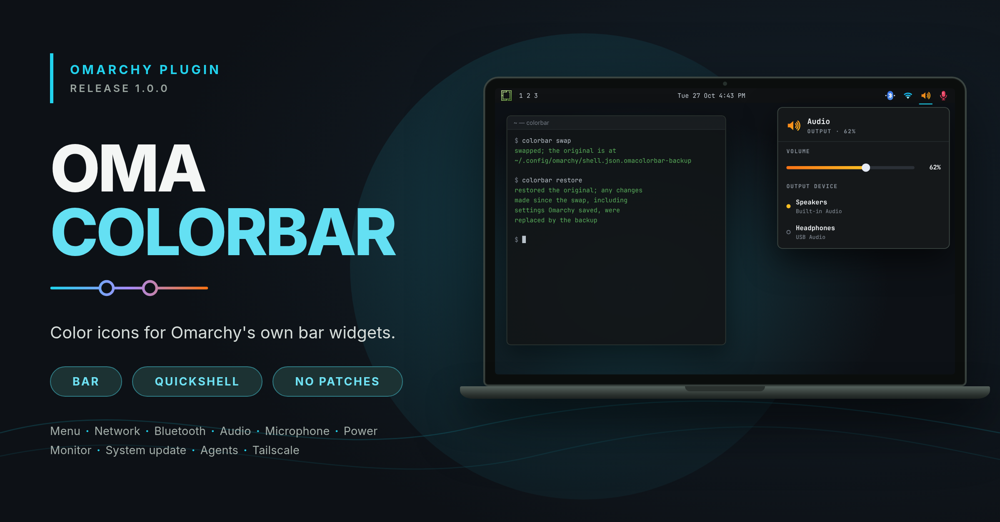

# OmaColorBar: color icons for Omarchy's bar

Color icons for Omarchy's built-in bar widgets, with color drawings for weather, tray apps that each show their own installed app icon, and a color icon for each open app. Each icon hosts the real Omarchy widget, so clicks and popups stay Omarchy's own. A hosted widget's own settings are read from `plugins[]` in `shell.json` (see Known limits). This plugin's own settings live on each copy's entry and can be changed from the bar (see Settings from the bar).



## What it does

Every copy of the widget wraps one built-in widget and only replaces its icon with a color one. The popup, click and scroll actions and tooltip come from the original, unchanged; the built-in widget's settings are read from `plugins[]`. The icon follows the widget's state (connected, muted, offline, ...).

Icons:

- `omarchy.menu` (Omarchy logo in green, or the Arch Linux logo in blue)
- `omarchy.network` (Wi-Fi, ethernet, offline)
- `omarchy.bluetooth` (off, on, connected)
- `omarchy.audio` (volume levels, muted, headphones)
- `omarchy.microphone` (on, muted)
- `omarchy.power`
- `omarchy.monitor` (one or many)
- `omarchy.system-update`
- `omarchy.agents`
- `omarchy.tailscale` (on, off, login needed)
- `omarchy.tray` (each tray app shows its own installed app icon, for example Claude and ChatGPT; apps without one keep their tray image; also shows the open apps, see Open apps)
- `omarchy.weather` (a color drawing for each condition)

## Install

```bash
omarchy plugin add https://github.com/alshareedah22/omacolorbar
~/.config/omarchy/plugins/blackcode.omacolorbar/colorbar swap
```

`colorbar swap` saves `~/.config/omarchy/shell.json` as `shell.json.omacolorbar-backup`, then replaces each supported built-in with a color copy in the same place. Settings of a swapped widget move to its `plugins[]` entry. Restart the shell afterwards: `omarchy restart shell`.

Do not use `--enable` on `plugin add`: it puts a bare `blackcode.omacolorbar` entry (default network icon) on the bar, and the swap then adds a real network copy too. If you already enabled it, remove the bare `blackcode.omacolorbar` entry (the one without `icon`).

`colorbar swap` and `colorbar restore` take an optional path to a `shell.json` (default `~/.config/omarchy/shell.json`), for example `colorbar swap ~/test/shell.json`. `swap` changes nothing, and writes no backup, when the layout has no supported built-in.

## Updating from 1.1.0

No swap is needed. After `omarchy restart shell`, the tray copy shows open apps. To turn that off, set `"openApps": false` on the tray copy.

## Updating from 1.0.0

```bash
~/.config/omarchy/plugins/blackcode.omacolorbar/colorbar swap --force
omarchy restart shell
```

This also swaps the tray and weather. `--force` keeps your original backup.

## Tray icons

A tray app gets its color icon by matching it to an installed app. The match tries the window class first, then the app's desktop file name, then the app name (compared with the tray item's title or tooltip). Generic Electron tray ids such as `chrome_status_icon_1` only match by title. The icon comes from the app's `.desktop` file (`Icon=`) through the icon theme. If nothing matches, or the icon fails to load, the tray keeps its own image.

Omarchy's bar weather shows only the condition icon (no temperature), so the drawing replaces that icon.

## Open apps

The `omarchy.tray` copy shows one color icon for each open app, inside the tray drawer. Collapsed, the tray shows only its `<` and pinned apps. Hover the `<` and the drawer opens: from left to right you see the `<`, the open apps (and `+N`), then the tray apps (for example Claude), then the pinned apps. Move away and they hide again. The drawer stays open while the pointer is on the open apps or one of their menus is open. OmaColorBar draws this one `<` for the whole group (right-click it for Omarchy's tray icons panel), also when no app has a tray icon. On a vertical bar the open apps stay visible below the tray.

- One icon per app. At 2 or more windows of the same app, the icon has a count badge.
- Click focuses the app's latest window. Click again to cycle through its windows.
- Apps beyond `openAppsLimit` (default 6) go behind `+N`. Click `+N` for a list and click an app in it to focus it.
- Right-click an icon and choose "Hide ... from bar" to hide that app. Right-click an icon or `+N` to see "Hidden apps" and click one to show it again. Right-click the same icon again, or click outside the bar, to close the menu.

Left out on purpose:

- Terminals (apps with the desktop category `TerminalEmulator`), unless `showTerminals` is on. Terminals are usually open all day and would fill the drawer.
- Apps the tray already shows (for example Claude), so they appear once.
- Windows whose app id matches no installed app, because there is no icon to show for them.

Hides made with a right-click are stored in the Quickshell state folder, in `~/.local/state/quickshell/by-shell/<id>/omacolorbar-hidden-apps.json`. The `hiddenApps` setting in `shell.json` adds manual hides (desktop entry ids). Those can only be removed there, not from the bar.

## Settings from the bar

Middle-click any color icon to open its settings card. Exceptions:

- Microphone and agents copies: plain middle-click keeps the widget's own action. Shift+middle-click opens the card.
- Tray copy: plain middle-click over the tray apps goes to the tray app, as in Omarchy. Middle-click over the `<` or the open apps opens the card. Shift+middle-click opens it anywhere.

Rows on the card:

- Widget: which built-in widget this copy shows. Only widgets not already on the bar as another copy are offered.
- Menu logo (menu copy): Omarchy or Arch.
- Open apps, Apps shown, Show terminals, Hidden apps (tray copy). Each hidden app has a Show button.
- Open shell.json.

Changes save at once, into that copy's own entry in `~/.config/omarchy/shell.json`. Only that entry changes. Before each save, the file is copied to `~/.config/omarchy/shell.json.omacolorbar-settings-backup`. This is one rolling copy, separate from the `colorbar swap` backup. If the copy cannot be found uniquely in the file, or the chosen widget is already used by another copy, nothing is written and the card says why. Changes show on the bar within seconds, with no restart. The card closes after each change, because Omarchy rebuilds the bar when a widget that appears more than once changes its settings; middle-click again for the next change.

## Settings

| Setting         | Values                                          | Default           |
|-----------------|-------------------------------------------------|-------------------|
| `icon`          | any widget listed above                         | `omarchy.network` |
| `menuLogo`      | `Omarchy`, `Arch` (for the `omarchy.menu` copy) | `Omarchy`         |
| `openApps`      | `true`, `false` (for the `omarchy.tray` copy)   | `true`            |
| `openAppsLimit` | 1 to 20 (for the `omarchy.tray` copy)           | `6`               |
| `hiddenApps`    | list of desktop entry ids (for the tray copy)   | `[]`              |
| `showTerminals` | `true`, `false` (for the tray copy)             | `false`           |

Menu logo: set `"menuLogo": "Arch"` or `"Omarchy"` on the copy set to `omarchy.menu`, or use the settings card.

Display scale: every icon follows the theme's sizes and the monitor scale. Images render at the screen's pixel density, so they stay sharp at scale 1, 1.5 and 2.

The built-in widget's own settings (for example `showPercentage` on power) live in its entry in `plugins[]` of `shell.json`. The copy reads them from there, so they apply when you edit `plugins[]` or use Omarchy's settings UI. The plugin's own settings above live on each copy's entry. A hosted widget cannot save them itself (see Known limits).

## Undo

```bash
~/.config/omarchy/plugins/blackcode.omacolorbar/colorbar restore
```

This puts the backup back and removes it. Any changes made since the swap, including settings Omarchy saved into `plugins[]`, are replaced by the backup.

`colorbar swap` refuses to run while a backup exists ("run restore first, or swap --force"). `swap --force` keeps the existing backup, which holds your original, and swaps the current file; it never overwrites the original.

You can also set the entries back by hand: replace `{"id":"blackcode.omacolorbar","icon":"omarchy.audio"}` with `{"id":"omarchy.audio"}`. The widget's settings stay in `plugins[]`, where Omarchy still reads them.

## Remove

Put the original bar back first, then remove the plugin:

```bash
~/.config/omarchy/plugins/blackcode.omacolorbar/colorbar restore
omarchy plugin remove blackcode.omacolorbar
```

If the backup is gone, replace each `{"id": "blackcode.omacolorbar", "icon": "<id>"}` entry in `~/.config/omarchy/shell.json` with `{"id": "<id>"}` before removing the plugin.

## When Omarchy changes

- A widget state with no color glyph yet falls back to the original glyph, so nothing goes blank.
- If a built-in widget disappears from Omarchy, its copy shows a warning icon instead of failing silently.
- If the same built-in is also on the bar directly, the copy's tooltip adds: "OmaColorBar: omarchy.audio is also on the bar directly".

## Known limits

- The hosted widget's own settings are not saved from the bar. (The plugin's own settings are, through the settings card.) Omarchy's shell scopes `updateEntryInline` to the calling plugin, so a hosted widget saving under its built-in id (power's right-click "show percentage", Tailscale's remembered choices) is denied and lasts only until the next restart. Set them in the widget's `plugins[]` entry or in Omarchy's settings UI instead; the copy re-reads `plugins[]`.
- The shell lets a plugin summon only widgets it owns, so hosted copies cannot open other panels: scrolling over the color audio or monitor icon changes the value but shows no on-screen display, and the Wi-Fi QR and speed-test actions in the network popup do nothing. Verified live for audio (scroll over the color icon changed the volume, no on-screen display appeared); the network and monitor cases are read from the shell source (`shell.qml`, `_summon`).
- Bluetooth's cross-monitor scan hand-off (`bar.moduleWidgets`) is unavailable to hosted copies.
- Popup shortcuts: `qs -p /usr/share/omarchy/shell ipc call omarchy.audio toggle` opens the popup of the color copy. `omarchy-shell shell toggle omarchy.audio` did not open it on the tested Omarchy version. Clicking the icon always works.
- Pin and Hide in the tray's manage panel ("Tray icons") have no effect when OmaColorBar hosts the tray, not even for the session. The tray saves them through a shell call that only works for Omarchy's own tray entry. To pin or hide an app, set `pinned` or `hidden` (lists of tray item ids, for example `"Claude_status_icon_1"`) in the `omarchy.tray` entry of `plugins[]` in `~/.config/omarchy/shell.json`, then run `omarchy restart shell`. Or keep the tray on Omarchy's own widget.
- Power settings (right-click to show the percentage) were not tested here: the test machine has no battery.
- Duplicate check (verified): with `omarchy.audio` added to the bar next to its color copy, the copy's tooltip shows the warning above.
- Indicators are not included: when another plugin hosts Omarchy's indicators, Stay awake, Night light and Do not disturb cannot read their state, so they would stay off. Keep `omarchy.indicators` as Omarchy's own widget.
- `omarchy.system-update` and `omarchy.power` can be hidden by Omarchy itself (no update pending, no battery). Their copies stay hidden too.

## Tests

```bash
node --test tests/
python3 -I -m unittest discover -s tests -p "test_*.py"
```

## Trademarks

The Arch Linux logo is a trademark of Arch Linux, shown unaltered in its official color. The Omarchy logo is Omarchy's.

## License

MIT
